# Sentinel: architecture evidence

This diagram shows what **is implemented and exercised in this repository** (left) and what is **planned but not built or validated** (right). The two meet only at the external-detections adapter. That adapter is an integration boundary with a defined schema and loader. It is **not** a working PipeGen connection.

```mermaid
flowchart LR
  subgraph LOCAL["Implemented: local Sentinel application (CPU, this repo)"]
    direction TB
    SRC["source.py<br/>video file · USB index · RTSP URL<br/>corrupt-frame skip · reconnect · URL redaction"]
    MET["metrics.py + baseline.py<br/>brightness · sharpness · obstruction · framing · processing time<br/>ratios to a validated healthy baseline"]
    HEALTH["health.py<br/>EMA + hysteresis + dwell timers<br/>HEALTHY → DEGRADED → UNTRUSTED → RECOVERING"]
    INC["incidents.py<br/>open · escalate · resolve / unverified<br/>evidence · thresholds · actions · recurrence"]
    RUN["pipeline.py (Monitor, run)"]
    OUT[("runs/RUN_ID/<br/>run.json · events.jsonl · incidents.json<br/>summary.json · evidence/*.jpg")]
    API["server.py (FastAPI)<br/>/api/status · /api/incidents · /api/events · /api/runs"]
    UI["Dashboard<br/>static/index.html"]
    MQTT["mqtt_sink.py<br/>optional, off by default"]
    DEMO["scenarios.py<br/>synthetic scene + deterministic degradations"]
    NULL["detector.py: NullDetector (default)<br/>no detections, nothing simulated"]

    DEMO -->|demo clips| SRC
    SRC --> MET --> HEALTH --> INC
    RUN -.coordinates.- SRC
    NULL --> RUN
    INC --> OUT --> API --> UI
    INC --> MQTT
  end

  subgraph BOUNDARY["Integration boundary (implemented, tested with a fixture only)"]
    direction TB
    SCHEMA["schema/detection_event.schema.json v1.0"]
    LOADER["detections_io.py<br/>strict validation · frame/time association<br/>CLI: --detections FILE.jsonl"]
    CONV["converter from PipeGen JSON<br/>NOT WRITTEN<br/>(parse_pipegen_metadata raises)"]
    SCHEMA --- LOADER
    CONV -.->|would emit| SCHEMA
  end

  subgraph PLANNED["Planned: PipeGen-generated DeepStream app (NVIDIA GPU / Jetson). Not built, not validated"]
    direction TB
    PG["PipeGen v0.5.1<br/>Requirement → Pipeline IR → Model → Compiler → Run"]
    TRT["TensorRT engine + PipeGen speed report"]
    DS["DeepStream app (run.sh)"]
    PGOUT["JSON metadata / MQTT<br/>(format not yet seen)"]
    PG --> TRT --> DS --> PGOUT
  end

  CAM(["same raw video source"])
  CAM --> SRC
  CAM -. planned .-> DS
  PGOUT -. planned .-> CONV
  LOADER -->|detection stats + detection_context| RUN
```

## Status of each component

| Component | Status | Evidence |
|---|---|---|
| Source, metrics, baseline, health engine, incidents, persistence, API, dashboard | Implemented and tested | 141 tests; [DEMO_REPORT.md](DEMO_REPORT.md) §4–7 |
| Synthetic demo generator | Implemented; output is **synthetic** | `make-demo`, `demo_manifest.json` |
| MQTT sink | Implemented, disabled by default; not tested against a real broker | `tests/test_mqtt.py` |
| ONNX CPU detector | Code exists; **never executed** (no weights) | — |
| Detection-event schema and loader | Implemented; tested with a **hand-written fixture** only | `tests/test_detections_io.py` |
| PipeGen → detection-event converter | **Not written.** It needs a genuine PipeGen output sample | `parse_pipegen_metadata()` raises `NotImplementedError` |
| PipeGen flow, TensorRT engine, DeepStream app, NVIDIA live run | **Not started** (no lab access, no NVIDIA hardware) | [`../GPU_VALIDATION.md`](../GPU_VALIDATION.md) |

## Design constraints at the boundary

- Sentinel monitors the **raw** source, never PipeGen's annotated output, because drawn boxes would distort the image metrics.
- Detections associate with frames by `frame_index`, falling back to `timestamp_s` within half a frame. A frame with no record means "no data", never "zero detections".
- PipeGen's frame numbering, box format and empty-frame behaviour must be confirmed on a real output sample before the converter is written.
